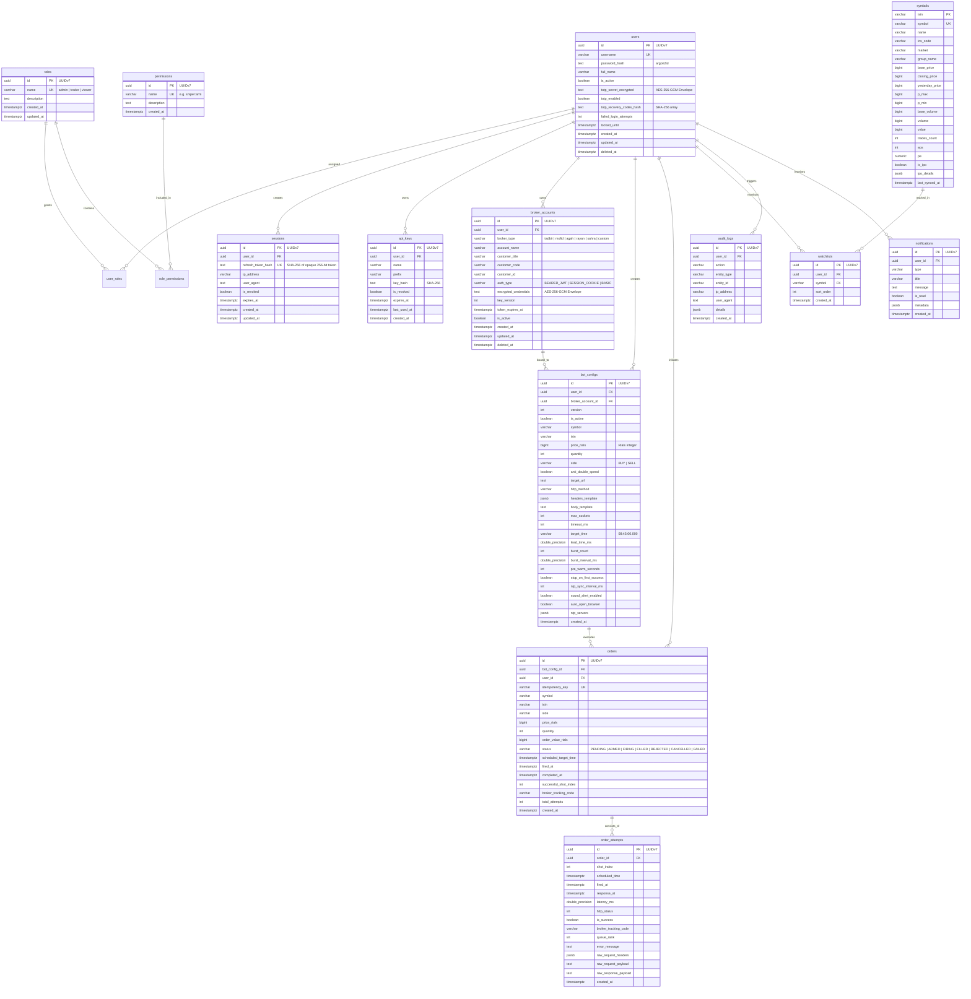

# SafShekan Architecture & Infrastructure Specification (Revised)
**Enterprise Data, Reliability, and Infrastructure Layer (PostgreSQL 17 + Redis 7)**
*Targeting High-Frequency TSE Sniping & Enterprise Operations (Stripe / Linear / Vercel Grade)*

---

## 1. Executive Summary & Security-First Vision

SafShekan (صف‌شکن) is an ultra-low latency Tehran Stock Exchange (TSE) IPO and Sarkhati (سرخطی) execution engine. The engine fires automated burst orders at micro-timed market openings (e.g., `08:45:00.000` with 3.5ms burst intervals) while storing live broker credentials that authorize real financial market transactions.

### Key Architectural Tenets:
1. **Security-First Rollout:** The application currently runs unauthenticated. Authentication and authorization (RBAC) are moved to the earliest deployment phases to seal endpoints before trading state migration.
2. **Zero-Trust Token & Cookie Architecture:** No tokens in `localStorage` or `Authorization` headers. Pure `httpOnly`, `Secure`, `SameSite=Strict` cookies with asymmetric Ed25519 access tokens, opaque 256-bit rotating refresh tokens with reuse family revocation, and CSRF Origin/Referer verification.
3. **Hot-Path Zero-Network-Call Guarantee:** During the 3.5ms firing loop, the sniper engine executes entirely from preloaded memory. It makes **zero** database and Redis network calls.
4. **Resilient Order Durability:** Order shot attempts are buffered in memory and persisted asynchronously via BullMQ. If Redis or BullMQ fails, an append-only JSONL fallback file on disk preserves every shot record, replayed automatically on next boot.
5. **Deterministic, Idempotent CLI Migration:** Migration of legacy `config.json` is a dedicated CLI command executed inside a single database transaction, preserving timestamped backups with zero data loss.

---

## 2. Technology Choices & Justification

### 2.1 Database ORM: Drizzle ORM + `postgres.js`
- **Zero Runtime Overhead:** A thin TypeScript wrapper over native `postgres.js`, adding no cold-start query engine penalties.
- **Pure ESM Native:** Seamless in NestJS 12 and Node 22 without Alpine musl binary incompatibility.
- **Deterministic SQL Migrations:** Versioned, plain SQL migration files executed with PostgreSQL advisory locks (`pg_advisory_lock`) in CI/CD to prevent concurrent migration races.

### 2.2 Redis 7 (Cache, Coordination, Queues)
- **Memory Cap:** Dynamically configured (default `128mb` if VPS RAM < 2GB, or `256mb` if RAM >= 2GB) with `volatile-lru` eviction and AOF persistence (`appendfsync everysec`).
- **Internal Network Isolation:** Strictly bound to Docker bridge network `safshekan-net` with password authentication (`requirepass`). No public port mapping.

---

## 3. Data Model & Entity Relationship Diagram (ERD)



---

## 4. Security Architecture: Zero-Trust Tokens, Cookies, 2FA & CSRF

### 4.1 Token Design & Transport (XSS-Immune)
1. **Asymmetric Ed25519 Access Tokens:**
   - Access tokens have a 10–15 minute lifespan.
   - Signed using an Ed25519 private key (`JWT_PRIVATE_KEY` / key file).
   - Verified using the corresponding public key (`JWT_PUBLIC_KEY`).
   - Includes a `kid` header for zero-downtime key rotation.
2. **Opaque 256-bit Rotating Refresh Tokens:**
   - Generated with `crypto.randomBytes(32).toString('hex')` (not a JWT).
   - Only its SHA-256 hash is persisted in the `sessions` table.
   - Rotated on every single refresh request.
   - **Reuse Detection & Token Family Revocation:** If an already-revoked refresh token hash is presented, the entire session family for that user is immediately revoked and an audit event (`AUTH_TOKEN_REUSE_DETECTED`) is raised.
3. **Cookie Transport Only:**
   - Both `access_token` and `refresh_token` are stored in `httpOnly`, `Secure` (production), `SameSite=Strict` cookies.
   - JavaScript cannot read either cookie, eliminating token theft via XSS.
   - The `Authorization: Bearer` header is **not** used by the frontend.
4. **CSRF Protection:**
   - Guard verifies `Origin` and `Sec-Fetch-Site` on all state-changing requests (`POST`, `PUT`, `PATCH`, `DELETE`).
   - Cross-origin requests without a matching Origin are rejected with 403 Forbidden.

### 4.2 Two-Factor Authentication (TOTP 2FA) & Account Lockout
- **Mandatory 2FA for Admins:** Standard traders can optionally configure TOTP (RFC 6238); users with the `admin` role **must** complete 2FA before accessing the system.
- **Hashed Recovery Codes:** 10 single-use recovery codes hashed with SHA-256 are generated during TOTP setup.
- **Brute-Force & Enumeration Protection:**
   - Rate limiting on login attempts per IP and per username in Redis.
   - Progressive backoff and temporary lockout (15 minutes) after 5 consecutive failures.
   - Generic error messages ("نام کاربری یا رمز عبور اشتباه است") to eliminate username enumeration.
- **Session Management:**
   - Endpoints to list active sessions with IP, user-agent, creation time, and last activity.
   - Users can revoke individual sessions or trigger "Log out all devices".

---

## 5. High-Frequency Trading Engine & Durability Architecture

### 5.1 Hot-Path Zero-Network-Call Isolation
```
[T minus 15 seconds: PRE-WARM PHASE]
  ├─ Query PostgreSQL: Fetch active BotConfig and decrypt broker credentials.
  ├─ Populate In-Memory Sniper Context: payload template filled, headers prepared.
  ├─ Undici HTTP Pool: Establish TCP/TLS handshake with broker server.
  └─ Single-Instance Redis Lock: Acquire order lock with fencing token.

[T minus 100 ms to T plus 50 ms: BURST FIRING (BURST INTERVAL: 3.5ms)]
  ├─ Spin-wait loop calibrated against Atomic Clock offset.
  ├─ Firing shots 1..N via pre-warmed Undici sockets.
  ├─ ZERO database calls.
  ├─ ZERO Redis queries.
  ├─ Results appended to in-memory shot array.
  └─ Anti-Double-Spend Circuit Breaker stops burst on first confirmed fill.

[POST-BURST: ASYNCHRONOUS PERSISTENCE]
  ├─ Fan-out results to WebSocket gateway via Redis Pub/Sub.
  ├─ Push shot metrics to BullMQ `order-archive` queue.
  └─ If Redis/BullMQ is down or buffer fills:
       Write append-only JSONL record to disk (`order-attempts.fallback.jsonl`).
       Background recovery replays fallback records to PostgreSQL on next boot.
```

### 5.2 Single-Instance Lock with Fencing Token & Idempotency
- **Single Redis Lock:** `SET safshekan:lock:order:<symbol> <fencingToken> NX PX 10000`
- **Fencing Token:** Monotonically increasing sequence integer. Prior to dispatching orders, the engine verifies its fencing token has not been superseded.
- **Unlocking:** Safe Lua compare-and-delete script.
- **Idempotency Keys:** Every order-arming and manual firing endpoint requires an `X-Idempotency-Key` (UUIDv7). Stored in Redis with 24-hour TTL and backed by a DB `UNIQUE (idempotency_key)` constraint.

---

## 6. Migration Plan & Advisory Locks

1. **Schema Migrations in CI/CD:**
   - Standalone deployment step before application containers start.
   - Uses `pg_advisory_lock(987654321)` to ensure only one runner executes migrations.
2. **Dedicated CLI Migration Command:**
   - `pnpm cli migrate-config` (or `pnpm --filter @saf-shekan/backend cli migrate-config`).
   - Runs in a single PostgreSQL transaction (`BEGIN ... COMMIT`).
   - Idempotent: safe to run multiple times.
   - Encrypts credentials with AES-256-GCM envelope encryption (tracking `key_version`).
   - Preserves `config.json.migrated.<timestamp>.bak`.
   - Never runs automatically on container boot.

---

## 7. Observability & Restricted Metrics

- **Structured JSON Logging:** Pino logger with automatic masking of cookies, tokens, and credentials.
- **Readiness & Liveness:** `/api/health` (liveness) and `/api/ready` (readiness checking DB + Redis).
- **Restricted `/api/metrics`:**
   - Restricted to internal Docker network or protected with basic auth / admin token.
   - Exposes request counts, latency histograms, database connection pool stats, cache hit rates, order attempt queue depth, and fallback JSONL write counts.
- **Graceful Shutdown:** `SIGTERM` handler drains open WebSocket connections, releases Redis locks, flushes buffered order shots, and closes DB pools.

---

## 8. Backup & Disaster Recovery Architecture

- **Backups Outside Container Volumes:** Automated `pg_dump` compressed with gzip saved to host directory `/opt/saf-shekan/backups/daily` and `/opt/saf-shekan/backups/weekly`.
- **Retention:** 7 daily + 4 weekly snapshots with SHA256 checksums.
- **Off-Server Copy:** Scripted integration with rsync / S3 / rclone documented in `DEPLOYMENT.md`.
- **Tested Restoration Script:** `scripts/restore-db.sh` verified in automated testing with connection termination and checksum validation.
